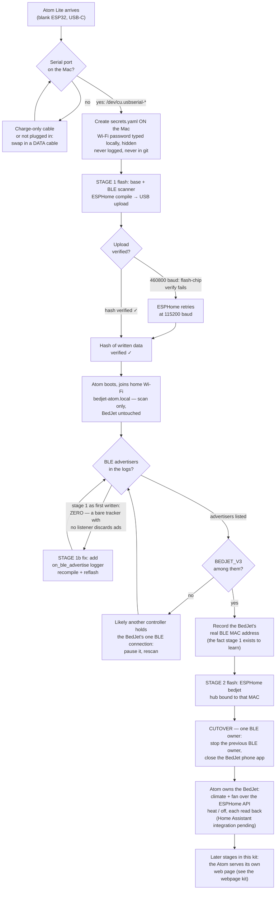
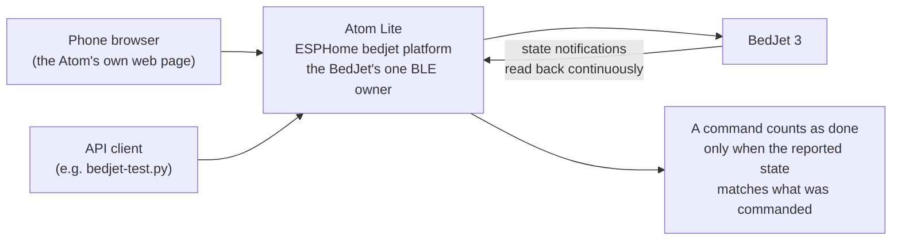

# BedJet Atom Build — ESPHome Control of a BedJet 3 on an M5Stack Atom Lite

A BedJet 3 speaks exactly one language: Bluetooth, to one connection
at a time, normally its phone app. It has no Wi-Fi, no cloud, and no
home-automation API. This build puts a ~$13 M5Stack Atom Lite next
to the bed and makes it the BedJet's Bluetooth owner, using
ESPHome's `bedjet` platform — so the bed gains a network control
surface (native ESPHome API + its own web page) without the phone
app, a hub, or a cloud account in the loop.

**Status: built, flashed, and live on the reference build.** The
Atom holds the BedJet's Bluetooth connection in daily use, and
control was verified by read-back: commands are only counted as
done when the device's reported state matches what was commanded
(`bedjet-test.py` in this kit is that test).

Originally built for Muse (Meta's personal AI agent) in the
author's household, and written up so it can be adapted to other
setups.

## The linked kits

This build is published as a linked pair, with an earlier companion:

- **Webpage layer — [BedJet Atom — Custom Web Page](https://gist.github.com/thatchmanai/758b096b155981c33e14ba9e604ce47f).**
  The custom control page the Atom serves (minimalist Liquid Glass
  UI, Fahrenheit on screen, everything else in Advanced Settings)
  is its own kit, and its README links back to this build as its
  parent. The page files are also included here (`bedjet-app.js` /
  `bedjet-app.css`, wired in by the `web_server:` block of
  `bedjet-atom.yaml`) so this kit is complete on its own — the
  webpage kit is the deep dive on how the page works.
- **Earlier companion — [Control a BedJet 3 from Python without Home Assistant](https://gist.github.com/thatchmanai/15893a08a0360ab75a4ed44c0b790041)**
  (gist, Nov 19, 2026). The same BedJet driven from a Mac over
  Bluetooth, no Atom required — the project this build grew out of.
- **Upstream.** ESPHome's `bedjet` component does the Bluetooth
  work; it builds on Nathan Spencer's
  [ha-bedjet](https://github.com/natekspencer/ha-bedjet) (MIT).
  All credit for talking to the BedJet belongs upstream.

## How it works

```
  Phone browser / API client
        |  Wi-Fi (your LAN)
        v
  M5Stack Atom Lite (ESP32)     bedjet-atom.yaml
  ESPHome `bedjet` platform     holds the BedJet's ONE BLE
        |                       connection, exposes climate + fan
        |  Bluetooth LE         + outlet/ambient temperature
        v
  BedJet 3
```

Two ideas do most of the work:

- **Two-stage flash.** A BedJet's real BLE MAC address is recorded
  nowhere — the phone app hides it and other controllers discover
  by advertised name. So stage 1 flashes a scanner-only firmware
  whose only job is to log nearby advertisers; you find the one
  advertising as `BEDJET_V3` and write its MAC into the stage 2
  config. One trap, learned the hard way and handled in the config:
  a bare `esp32_ble_tracker` with no listener silently discards
  advertisements — the `on_ble_advertise` trigger in
  `bedjet-atom-scan.yaml` is what actually prints them.
- **One BLE owner, by cutover.** The BedJet accepts a single
  Bluetooth connection. The stage 2 flash therefore validates and
  compiles *before* anything is stopped, then stops the previous
  owner (a watcher program, in the reference build), requires the
  phone app fully closed, and only then flashes. If the upload
  fails, the script restores the previous owner. The config also
  includes an "Enable BedJet Connection" switch so the connection
  can be handed back to the phone app without unplugging the Atom.
  The RF remote always works, regardless.

## Files

| File | What |
|---|---|
| `esphome/bedjet-atom-scan.yaml` | Stage 1: base + BLE scanner firmware (find the BedJet's MAC). |
| `esphome/bedjet-atom.yaml` | Stage 2: the BedJet control firmware, with the web page wired in. **The BLE MAC in it is a placeholder — replace it with yours.** |
| `esphome/bedjet-app.js` / `esphome/bedjet-app.css` | The custom web page (see the webpage kit, linked above). |
| `esphome/flash-stage1.command` | macOS flash script for stage 1: installs ESPHome in a venv, creates `secrets.yaml` on that Mac (prompted, hidden, never logged), validates, compiles, flashes over USB, captures scan logs. |
| `esphome/flash-stage1b.command` | Re-flash of stage 1 with the advertise-listener logger, if the first scan logs nothing. |
| `esphome/flash-stage2.command` | The cutover flash: validate + compile first, stop the previous BLE owner, flash, capture logs. Set `WATCHER_LABEL` in it to your own previous owner's LaunchAgent label, or leave the placeholder (a missing agent is reported, not fatal). |
| `esphome/bedjet-test.py` | Read-back verification over the ESPHome API: commands HEAT then OFF and fails unless the reported state matches each time. Address from `BEDJET_ATOM_ADDRESS`, default `bedjet-atom.local`. Reads the API key from `secrets.yaml` locally; never prints it. |
| `esphome/secrets.example.yaml` | Copy to `secrets.yaml` on the flashing Mac and fill in there. Never commit a real `secrets.yaml`. |
| `esphome/WHEN-YOU-PLUG-IT-IN.md` | The short runbook version of the procedure below. |
| `docs/algorithmic-visual.md` | The two diagrams below in full, with the evidence (honesty-box) notes. |

## Install, in order

You need: an M5Stack Atom Lite, a Mac to flash from, a USB-C
**data** cable (a charge-only cable powers the Atom but cannot
flash it), and your Wi-Fi credentials.

1. **Stage the kit.** Copy the contents of this kit's `esphome/`
   folder into one folder on the flashing Mac — the configs, page
   files, and flash scripts all reference each other as siblings,
   so they must stay together. Do **not** rename `secrets.example.yaml` to
   `secrets.yaml` — if a `secrets.yaml` already exists, the flash
   script reuses it as-is and never prompts, so an example file
   would be taken for real credentials. Either fill in a
   `secrets.yaml` yourself from the example (real values, on that
   Mac only), or leave it absent and `flash-stage1.command` will
   create it with prompts.
2. **Stage 1 — scan.** Plug the Atom into the Mac and run
   `flash-stage1.command`. Enter the Wi-Fi SSID and password when
   prompted (typed on that Mac, stored only in `secrets.yaml`
   there). After the flash, plug the Atom into any USB charger
   within Bluetooth range of the bed and read `scan-log.txt`:
   find the advertiser named `BEDJET_V3` and note its MAC address.
   If the log shows no devices at all, run `flash-stage1b.command`
   (the listener version) and read `scan-log-1b.txt` instead.
3. **Fill in stage 2.** Put the MAC you found in `bedjet-atom.yaml`
   in place of the `XX:XX:XX:XX:XX:XX` placeholder under
   `ble_client:`.
4. **Stage 2 — cutover.** Fully close the BedJet phone app, and
   stop anything else that holds the BedJet's Bluetooth connection.
   Then run `flash-stage2.command`. It validates and compiles
   before stopping anything, so a config error leaves your current
   setup untouched.
5. **Verify.** Run `bedjet-test.py` (needs `aioesphomeapi`:
   `pip install aioesphomeapi`). It connects over the ESPHome API,
   commands HEAT and reads the state back, then commands OFF and
   reads back again, and exits non-zero on any mismatch. Then open
   `http://bedjet-atom.local` for the web page.

After the first USB flash, later updates can go over the air:
`esphome run bedjet-atom.yaml` uploads via OTA when the Atom is on
your Wi-Fi.

## Limits and warnings

- **One Bluetooth owner, always.** While the Atom holds the
  connection the phone app cannot connect (use the config's
  connection switch to hand it back), and while the app holds it
  the Atom cannot. Plan the cutover; don't fight over the bed.
- **LAN-only, no authentication on the web page.** ESPHome's web
  server has optional login available but it is not enabled in
  this build; anyone on your Wi-Fi can open the page and control
  the bed. Do **not** port-forward it or expose it to the
  internet. The native API and OTA are protected by the secrets in
  your `secrets.yaml` — which is why that file never leaves the
  flashing Mac and is never committed.
- **Secrets live in one place.** Wi-Fi password, API encryption
  key, OTA and fallback-AP passwords exist only in `secrets.yaml`
  on the flashing Mac and on the device. The flash script creates
  that file with owner-only permissions from the moment it exists
  and never writes a secret to its logs.
- **BedJet 3 only.** The ESPHome `bedjet` platform targets the
  BedJet 3 (the reference unit runs firmware V1.20).
- **Not in this kit:** a Home Assistant integration (the Atom
  exposes the standard ESPHome API, so HA can adopt it, but that
  step is separate and was still pending on the reference build),
  and any voice-assistant/Alexa layer — that is a different project
  and explicitly out of scope here.
- **One BedJet, one Atom.** Multi-device is out of scope.

## Diagrams

Full version, with the evidence notes: [docs/algorithmic-visual.md](docs/algorithmic-visual.md).

**1. Provisioning the Atom Lite** — the two-stage flash as an
algorithm, failure branches included:



**2. The system the Atom serves** — and the read-back rule:



## Provenance

Built Nov 23–24, 2026 in stages: stage 1 scan (and the 1b listener
fix), stage 2 cutover with the watcher stopped and the Atom taking
the BLE connection, read-back test passed the same night, then the
web page stages that became the linked webpage kit above. The
provisioning story — baud-rate fallback on the first flash, the
silent-tracker trap, the one-owner cutover — is the interesting
part, and it is all in the scripts' and configs' comments, where
it happened.
