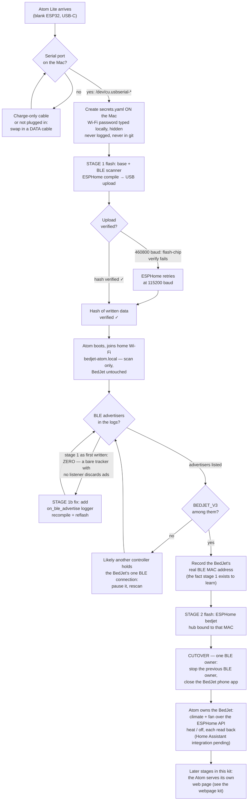
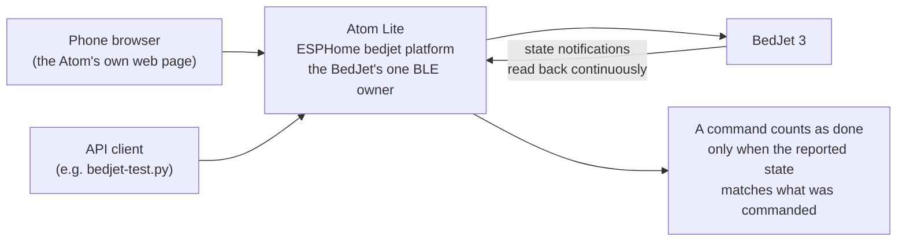

# Algorithmic visual — what we are doing to this ESP32

From the BedJet Atom build, Nov 23–24, 2026. Built as Mermaid so
GitHub renders it natively — no image pipeline needed, and the
diagram stays diff-able in git. The same two diagrams are embedded
in the repo README; this file is the full version, with the
evidence notes.

Two diagrams:
1. **The provisioning algorithm** — the ESP32's own story: two-stage
   flash, with every real branch that was hit or planned for.
2. **The system it serves** — what talks to the Atom, what the Atom
   owns, and the read-back rule that decides when a command counts
   as done. (The original writeup's second diagram covered a
   separate voice front-door project that would swap in as this
   device's consumer; that project is out of scope for this kit
   and its diagram is omitted here.)

---

## 1. Provisioning the Atom Lite (M5Stack Atom, ESP32-PICO-D4)

What already happened — the honesty box (verified Nov 23–24,
2026). Evidence discipline: the flash and scan logs from the
reference build are session records and are NOT included in this
repo — they contain household identifiers and neighbouring
devices. The summary: the serial port appeared the moment the
Atom was plugged in; the first upload at 460800 baud failed
flash-chip verification and ESPHome's automatic 115200 retry
wrote 1,328,752 bytes with the hash verified; the Atom joined the
home Wi-Fi, and the stage 1 scan then logged zero devices, which
is the branch that produced stage 1b. Stage 1b then worked
exactly as designed: 1,877 advertise lines in the capture window,
and BEDJET_V3 among them — 49 advertisements carrying the name,
RSSI mostly −70 to −75 dBm from the flashing Mac's room. The H1
branch (another controller holding the connection suppressing
advertisements) never triggered: the BedJet advertises even while
another controller exists. One wart worth telling: logging every
advertiser at INFO tripped the ESP32 task watchdog once — the
scanner firmware is a throwaway diagnostic, and stage 2 doesn't
carry that logging. Stage 2 then flashed (the previous owner
stopped by the flash script), the Atom connected to the BedJet
and pushed status every 15 s, and the API read-back test passed
end to end: HEAT 38 °C read back as HEAT, OFF read back as OFF,
exit 0. The test took four runs to pass, and the failures are
part of the story: run 1 hit a transient "No route to host"
minutes after boot; runs 2–4 peeled three aioesphomeapi traps
(awaiting sync methods, a nonexistent `percentage` kwarg,
IntEnum string formatting) — and run 3's "failed" HEAT command
had in fact landed, which the next run's as-found state (HEAT,
38 °C) proved.

## 2. The system the Atom serves

---

## Notes

- Both diagrams live in this repo as Mermaid source; GitHub
  renders them in the README and in this doc with no build step.
- Stage 2 has run (Nov 23, 2026), so diagram 1 is history, not
  plan — keep the rule that produced this doc: never present
  planned steps as done.
